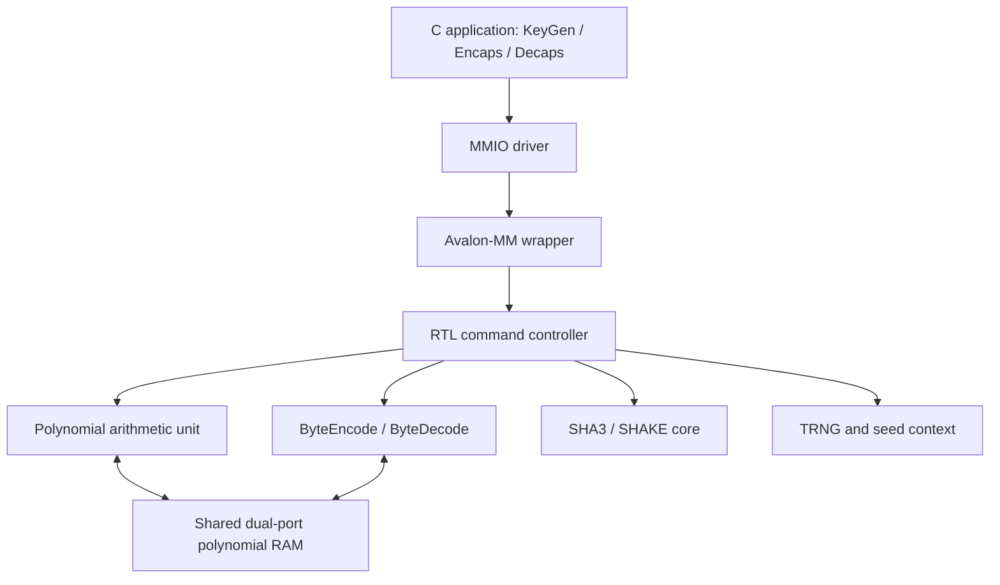

# ML-KEM FPGA Accelerator with ARM Software Integration

A modular Verilog-2001 accelerator and portable C99 implementation of
**ML-KEM-512, ML-KEM-768, and ML-KEM-1024**, targeting the Cyclone V SoC on the
DE10-Nano. The project implements key generation, encapsulation, and
decapsulation according to [NIST FIPS 203](https://nvlpubs.nist.gov/nistpubs/FIPS/NIST.FIPS.203.pdf),
with FPGA acceleration for polynomial arithmetic and SHA3/SHAKE operations.

The complete KEM algorithm is controlled by C software. The RTL executes
individual commands through an Avalon-MM interface, providing a reusable
component for integration with the ARM Cortex-A9 HPS in Platform Designer.
A software backend supports the same C API without an FPGA.

**Current results:** functional tests and C-to-RTL co-simulation pass for all
three parameter sets. Quartus placement and routing completed successfully,
using **8,369 ALMs and 2 DSP blocks**, with a reported maximum clock frequency
of **41.85 MHz**. **41 MHz is a candidate operating target** to verify with
complete system constraints. Physical board execution remains to be tested.

## Functionality and Data Flow

| Operation | Inputs | Outputs |
|---|---|---|
| KeyGen | Two 32-byte seeds, `d` and `z` | Encapsulation key `ek` and decapsulation key `dk` |
| Encaps | `ek` and 32-byte randomness `m` | Ciphertext and a 32-byte shared secret |
| Decaps | `dk` and ciphertext | A 32-byte shared secret; implicit rejection selects a replacement secret when ciphertext verification fails |

The randomized C APIs obtain seeds through a callback. The `_derand` APIs
accept explicit `d`, `z`, and `m` for reproducible known-answer tests.

| Parameter set | Encapsulation key | Decapsulation key | Ciphertext | Shared secret |
|---|---:|---:|---:|---:|
| ML-KEM-512 | 800 bytes | 1,632 bytes | 768 bytes | 32 bytes |
| ML-KEM-768 | 1,184 bytes | 2,400 bytes | 1,088 bytes | 32 bytes |
| ML-KEM-1024 | 1,568 bytes | 3,168 bytes | 1,568 bytes | 32 bytes |

## Architecture



| Layer | Responsibilities | Main implementation |
|---|---|---|
| C algorithm controller | Full KEM/K-PKE sequence, key checks, serialization, and implicit rejection | [`mlkem.c`](software/src/mlkem.c) |
| C sampling and conversion | SampleNTT, CBD, Compress/Decompress, and bit packing | [`poly.c`](software/src/poly.c) |
| Software hash backend | SHA3-256/512 and SHAKE128/256 | [`keccak.c`](software/src/keccak.c) |
| Accelerator driver | MMIO transfers, readiness polling, completion, error handling, and backend callbacks | [`mlkem_accel.c`](software/src/mlkem_accel.c) |
| Avalon-MM wrapper | 32-bit registers, RAM access, stream transport, sticky status, reset, and IRQ | [`mlkem_avalon_wrapper.v`](rtl/mlkem_avalon_wrapper.v) |
| RTL command controller | Captures command parameters and arbitrates shared RAM and hash ownership | [`mlkem_top.v`](rtl/mlkem_top.v) |
| Arithmetic datapath | NTT, INTT, NTT-domain multiplication, accumulation, and modular addition | [`mlkem_pau_engine.v`](rtl/mlkem_pau_engine.v), [`pau_core.v`](rtl/pau_core.v) |
| Hash and seed generation | SHA3/SHAKE, ring oscillators, conditioning, and seed registers | [`sha3_keccak_core.v`](rtl/sha3_keccak_core.v), [`trng_core.v`](rtl/trng_core.v) |

With the FPGA backend, the C controller offloads polynomial and hash
operations while retaining sampling, compression, and KEM sequencing in C.
SampleNTT uses software SHAKE128 streaming for rejection sampling. Starting
the RTL launches one component operation; calling a C KEM API runs the
complete algorithm.

### RTL Commands and Interface

| Command | Operation | Result |
|---:|---|---|
| 0 | NTT | In-place transform of slot A |
| 1 | INTT | In-place inverse transform of slot A |
| 2 | PWM | NTT-domain base multiplication of A and B into D |
| 3 | MAC | Accumulate `PWM(A, B)` into D |
| 4 | ADD | `D = A + B mod 3329` |
| 5 | ByteEncode_12 | Serialize a polynomial into 384 bytes |
| 6 | ByteDecode_12 | Decode 384 bytes into slot D |
| 7 | SHA3 / SHAKE | Hash or extend a host-provided byte stream |
| 8 | Polynomial-to-hash | Feed ByteEncode_12 output directly into the hash core |
| 9 | TRNG seed generation | Produce a seed and `G(seed \|\| 0x02)`, exposing seed/rho/sigma registers |

The Avalon-MM interface uses a **14-bit byte address**, **32-bit data**, four
byte enables, `waitrequest`, and `readdatavalid`, with a **16 KiB address span**.
The shared RAM contains **2,048 x 24-bit words**, organized as **16 polynomial
slots**. Each slot holds 256 coefficients, packed two per word. Arithmetic
uses canonical coefficients from 0 to 3328.

The controller permits one active command. The driver checks readiness
before accessing stream registers, then polls completion and reads results.
See the [ARM integration guide](docs/INTEGRASI_ARM.md) for the register map
and the [RTL interface contract](docs/ANTARMUKA_TOP.md) for component handshakes.

## Implementation and Optimizations

- **Shared polynomial storage:** the PAU and transcoder use one dual-port RAM,
  avoiding separate polynomial memories in each block. NTT and INTT operate
  in place, and two 12-bit coefficients share each 24-bit word.
- **Pipelined modular multiplication:** two three-stage multiplier pipelines
  use Barrett reduction with `q = 3329` and `mu = 5039`. Constant products use
  shifts and additions/subtractions, avoiding hardware division and modulo.
  The fitted arithmetic datapath occupies two DSP blocks.
- **Iterative hash core:** Keccak-f[1600] processes one round per cycle and
  reuses the same datapath for SHA3 and SHAKE. A 21-word output buffer adds
  backpressure support at the TOP interface.
- **Direct serialization-to-hash path:** command 8 connects the transcoder
  to the hash core without a host read-and-write round trip.
- **Controlled memory access:** a central FSM gives exclusive ownership to
  the host, PAU, or transcoder. A slot-valid bitmap invalidates stored
  polynomials on reset without clearing every RAM word.
- **Portable software workspace:** the C library uses caller-provided output
  buffers and fixed workspace, with no heap allocation. Backend callbacks
  allow the same algorithm to run in software, co-simulation, or on the HPS.

The integrated transcoder also corrects the original decode nibble packing,
synchronous RAM read timing, output handshake, and completion pulse behavior.
Implementation details and the reproduced original defect are documented in
[component changes](docs/PERUBAHAN_KOMPONEN.md).

## Verification Results

The saved regressions compare exact coefficients, encoded bytes, keys,
ciphertexts, and shared secrets against independent references. C-to-RTL
co-simulation connects the compiled C driver to the running Icarus HDL
simulator through Avalon-MM transactions.

| Verification | Recorded coverage | Result |
|---|---|---|
| RTL component TOP | 82 PAU vectors, 179 commands, 22,272 coefficient comparisons, and 84 hash cases | PASS |
| PAU datapath | 36,645 modular multiplications and 408 core cases | PASS |
| SHA3 component | 191 cases and 6,146 output words | PASS |
| Avalon-MM wrapper | 171 commands, 21,504 coefficient comparisons, 384 encoded bytes, and 2,426 hash words | PASS |
| C known-answer tests | 75 KeyGen, 75 Encaps, 30 Decaps, and 60 key checks using NIST vectors | PASS |
| C primitive and roundtrip tests | 24 roundtrips, 24 implicit-rejection cases, 160 hash cases, 19,767 compression checks, and 30 sampling cases | PASS |
| C-to-RTL co-simulation | All three parameter sets: NIST KeyGen/Encaps, valid Decaps, modified-ciphertext rejection, and driver encode/decode | PASS |
| TRNG seed path | Two fresh RTL seed sessions per parameter set; seed-derived keys, KEM roundtrip, and stalled-source recovery | PASS in simulation |
| ARM cross-build | Cortex-A9 Linux hard-float executable | PASS; execution on ARM pending |
| Platform Designer component | IP descriptor lint | PASS; 0 errors and 0 warnings |

Protocol tests cover reset during execution, recovery, busy-state access,
invalid inputs, byte enables, IRQ acknowledgement, stream backpressure, and
driver timeout behavior. A deliberately incorrect expected value is also
rejected by the testbench checker.

Evidence: [TOP summary](results/test_summary.json),
[wrapper summary](results/avalon_summary.json), [C summary](results/c_summary.json),
[TRNG summary](results/trng_rng_summary.json), and
[ARM build summary](results/arm_build_summary.json).
Per-set co-simulation values are saved for
[ML-KEM-512](results/cosim/mlkem_512/values.json),
[ML-KEM-768](results/cosim/mlkem_768/values.json), and
[ML-KEM-1024](results/cosim/mlkem_1024/values.json).
The [co-simulation summary](results/cosim_summary.json) records the latest
invocation, which currently covers ML-KEM-512; the per-set files retain the
successful results for all three sets.

NIST fixtures are included under [`reference/acvp/`](reference/acvp/).
Their source commit and SHA-256 checksums are recorded in the
[fixture manifest](reference/acvp/manifest.json). Functional agreement with
these vectors is distinct from formal NIST certification.

## FPGA Implementation Results

The following results come from the **8 October 2026** Quartus Prime Lite
**25.1** implementation of `mlkem_avalon_wrapper` on Cyclone V
**5CSEBA6U23I7**, with `USE_EXTERNAL_ENTROPY=0` and eight internal ring
oscillators. The Fitter completed successfully with final timing models.

### Resource Utilization

| Resource | Used | Device capacity | Approximate utilization |
|---|---:|---:|---:|
| Adaptive Logic Modules (ALMs) | 8,369 | 41,910 | 19.97% |
| Registers | 5,726 | — | — |
| Block memory bits | 50,496 | 5,662,720 | 0.89% |
| RAM blocks | 7 | 553 | 1.27% |
| DSP blocks | 2 | 112 | 1.79% |
| I/O pins, standalone wrapper | 97 | 314 | 30.89% |
| PLLs | 0 | 6 | 0% |

These figures describe the standalone accelerator; a complete HPS/board
system will have its own resource and pin assignments. Source:
[preserved Fitter summary](results/avalon_quartus_fit.summary).

### Timing

| Metric | Reported value |
|---|---|
| Clock constraint used for analysis | 50 MHz / 20 ns |
| Reported Fmax and restricted Fmax | 41.85 MHz |
| Candidate operating target | 41 MHz / approximately 24.39 ns |
| Worst setup slack (WNS) at 50 MHz | -3.896 ns |
| Setup endpoint TNS at the worst corner | -5.118 ns |
| Worst hold slack | +0.120 ns |
| Hold TNS | 0.000 ns |
| Worst setup/Fmax corner | Slow 1100 mV, 100 degrees C |
| Worst hold corner | Fast 1100 mV, -40 degrees C |

The implementation reports a maximum frequency of **41.85 MHz**, making
**41 MHz a suitable candidate target** with a small frequency margin. The
negative setup slack corresponds to the original 50 MHz constraint; the
analyzed hold paths have positive slack. The existing SDC still requests
50 MHz. Operation at 41 MHz must be confirmed by updating the clock
constraint and rerunning implementation and timing analysis.

The timing report contains **53 unconstrained input ports and 35
unconstrained output ports**. Interface/reset constraints, asynchronous
entropy paths, and reported combinational loops require review during HPS
integration. These results are a post-fit timing snapshot for the constrained
paths, with full system timing closure still pending. Sources:
[timing summary](results/avalon_quartus_sta.summary) and
[full timing report](results/avalon_quartus_sta.rpt).

### Component Latency

| Operation | Simulated command latency |
|---|---:|
| NTT | 3,139 cycles |
| INTT | 3,139 cycles |
| PWM | 1,411 cycles |
| MAC | 1,795 cycles |
| ADD | 387 cycles |

These are RTL command cycle counts from the TOP regression, excluding host
transfers and stalls. They are separate from complete KEM latency and ARM
application throughput, which have not been measured on the board.

## Build and Run

Run the following commands from the repository root. Functional regressions
require **Python 3.10+**, a **GCC/Clang host compiler**, and **Icarus Verilog**
(`iverilog` and `vvp`) on `PATH`.

```sh
# Component TOP regression
python scripts/run_tests.py

# Avalon-MM wrapper regression
python scripts/run_wrapper_tests.py

# Complete C algorithm and primitive tests
python scripts/run_c_tests.py

# Compiled C driver connected to RTL, all three parameter sets
python scripts/run_cosim_tests.py --wave

# Separate TRNG seed-path regression
python scripts/run_trng_rng_tests.py --wave
```

Use `--cc` or `MLKEM_CC` to select the host compiler. NIST vectors are included,
so test execution does not require network access or MATLAB.

To run only ML-KEM-512 and inspect its outputs:

```sh
python scripts/run_cosim_tests.py --sets 512 --wave
gtkwave results/cosim/mlkem_512/wave.vcd
```

The output directory contains `values.txt`, `values.json`, byte-per-line
`.hex` files, `wave.vcd`, `mmio.csv`, and `simulator.log`. These expose `d`,
`z`, `ek`, `dk`, ciphertext, shared secrets, and timestamped RTL transactions.
Keys are assembled in C; their complete byte arrays are in the value files.
See [viewing co-simulation results](docs/MELIHAT_HASIL_COSIM.md).

### Quartus Project

Open **[`quartus/mlkem_avalon.qpf`](quartus/mlkem_avalon.qpf)** for the current
accelerator, then run compilation and Timing Analyzer. Its associated
[`mlkem_avalon.qsf`](quartus/mlkem_avalon.qsf) includes all required RTL and
[`mlkem_top.sdc`](quartus/mlkem_top.sdc).
The component-only project [`mlkem_top.qpf`](quartus/mlkem_top.qpf) remains
available with an external entropy input.

The `TRNG_SIM` definition is used only in HDL tests; FPGA builds use the
physical ring-oscillator implementation.

### ARM Linux Application

Build for Cortex-A9 Linux with an ARM hard-float toolchain:

```sh
python scripts/build_arm.py
```

Use `--cc` or `MLKEM_ARM_CC` to select a compiler compatible with the board's
Linux image. The output is `build/arm/mlkem_hps_demo`. After copying the
executable to the board:

```sh
./mlkem_hps_demo --software 512
sudo ./mlkem_hps_demo --mmio PHYSICAL_BASE 512
```

Replace `PHYSICAL_BASE` with the actual numeric address from the Platform
Designer memory map. The demo runs KeyGen, Encaps, and Decaps, then prints
`PASS` and output sizes when both shared secrets match.
[`software/CMakeLists.txt`](software/CMakeLists.txt) also supports building
the library and Linux demo with CMake.

## Seed Configuration and Board Integration

KeyGen seed selection is controlled by one variable in
[`software/src/mlkem_rng.c`](software/src/mlkem_rng.c):

```c
mlkem_rng_source mlkem_keygen_rng_source = MLKEM_RNG_CPU;
```

The default Linux demo obtains `d` and `z` from `/dev/urandom`. Change the
initializer to `MLKEM_RNG_TRNG` and rebuild to obtain them through two fresh
hardware seed sessions. The driver drains command 9's hash output before
reading each seed. The KEM algorithm computes `G(d || k)` separately through
command 7 for the selected parameter set. Encapsulation randomness `m`
continues to use the CPU RNG in the demo.

The primary co-simulation always uses CPU-supplied NIST `d`/`z` fixtures.
The separate TRNG regression verifies the digital seed path with a
deterministic simulation model; physical entropy quality remains to be
assessed on the board. See [seed-source configuration](docs/SUMBER_SEED_D_Z.md).

For deployment, add [`ip/mlkem_accel_hw.tcl`](ip/mlkem_accel_hw.tcl) to the
Platform Designer IP catalog, connect the accelerator to the lightweight
HPS-to-FPGA bridge, assign its 16 KiB address span, and configure clock/reset
and any required clock-domain crossing. Complete the DE10-Nano HPS DDR,
pin assignments, constraints, FPGA image, and Linux bridge configuration
using the [integration guide](docs/INTEGRASI_ARM.md).

The delivered Quartus project is a standalone accelerator implementation.
Physical board execution, ARM throughput, physical TRNG characterization,
and side-channel evaluation remain open validation work.

## Repository Structure

| Directory | Contents |
|---|---|
| [`rtl/`](rtl/) | Synthesizable modules; `files.f` and `files_avalon.f` source lists |
| [`software/`](software/) | C99 KEM library, MMIO driver, RNG selector, tests, and Linux demo |
| [`ip/`](ip/) | Platform Designer component descriptor |
| [`tb/`](tb/) | Self-checking HDL testbenches and co-simulation transport |
| [`reference/`](reference/) | Independent reference generators and NIST fixtures |
| [`scripts/`](scripts/) | Build, verification, and result-export tools |
| [`quartus/`](quartus/) | FPGA projects and clock constraints |
| [`sim/`](sim/) | Questa simulation scripts |
| [`results/`](results/) | Saved summaries, comparison values, waveforms, and Quartus reports |
| [`docs/`](docs/) | Architecture, interfaces, integration, and verification guides, primarily in Indonesian |
| [`vendor/`](vendor/) | Original component sources retained for provenance |

[`BUKA_HASIL.html`](BUKA_HASIL.html) provides an overview of the original
component TOP regression. The implementation and verification results in
this README describe the expanded C/RTL accelerator project.

## Authors

| Team member | Name | Institution | Email |
|---|---|---|---|
| 1 | Sarah Beatrix Sitorus | Institut Teknologi Bandung | [sarahbeatrixsitorus@gmail.com](mailto:sarahbeatrixsitorus@gmail.com) | 
| 2 | Rifki Afriadi | Institut Teknologi Bandung | [rifki.afriyadi@gmail.com](mailto:rifki.afriyadi@gmail.com) | 
| 3 | Maghryza Milchan Fayumi | Institut Teknologi Bandung | [maghryza.milchan@gmail.com](mailto:maghryza.milchan@gmail.com) |
## References

- [NIST FIPS 203: Module-Lattice-Based Key-Encapsulation Mechanism Standard](https://nvlpubs.nist.gov/nistpubs/FIPS/NIST.FIPS.203.pdf)
- [NIST FIPS 202: SHA-3 Standard](https://nvlpubs.nist.gov/nistpubs/FIPS/NIST.FIPS.202.pdf)
- [NIST ACVP-Server test vectors](https://github.com/usnistgov/ACVP-Server)
